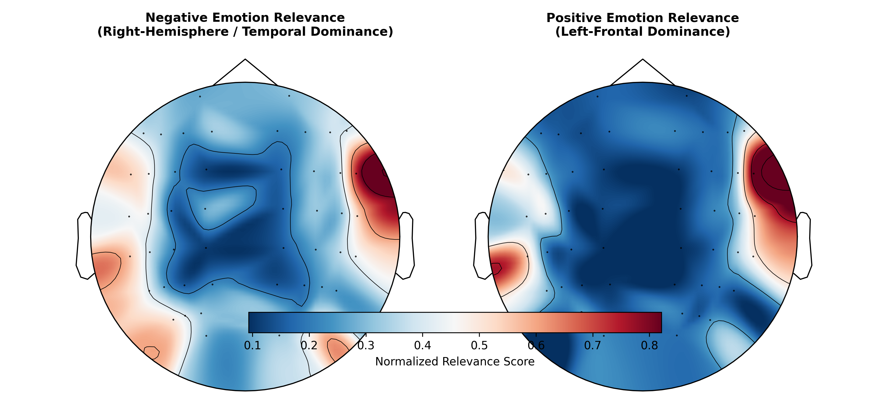
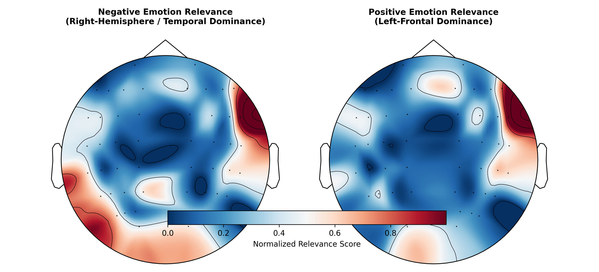
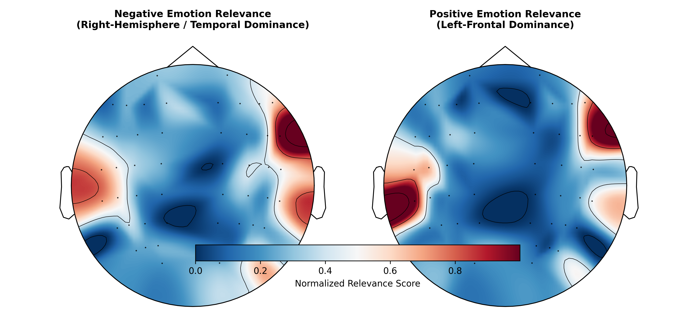
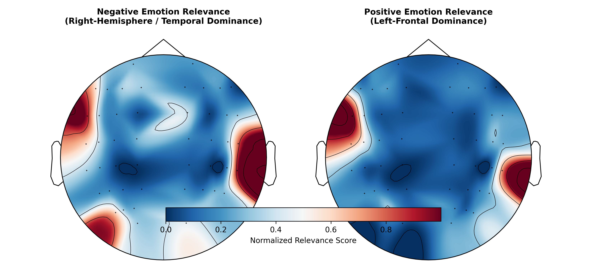
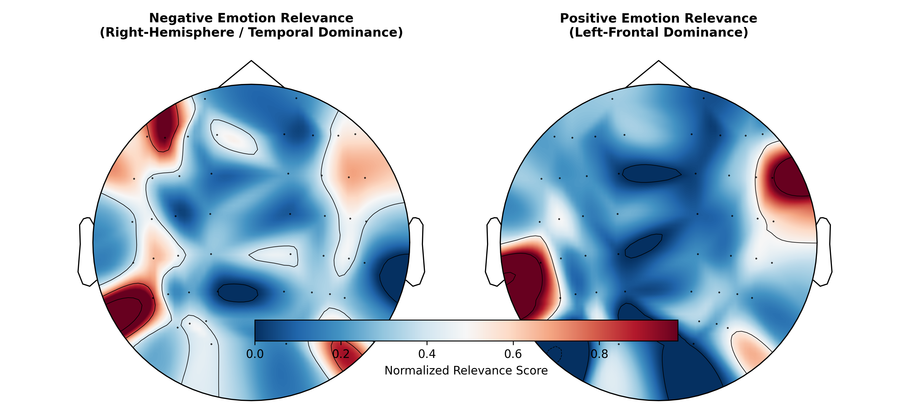
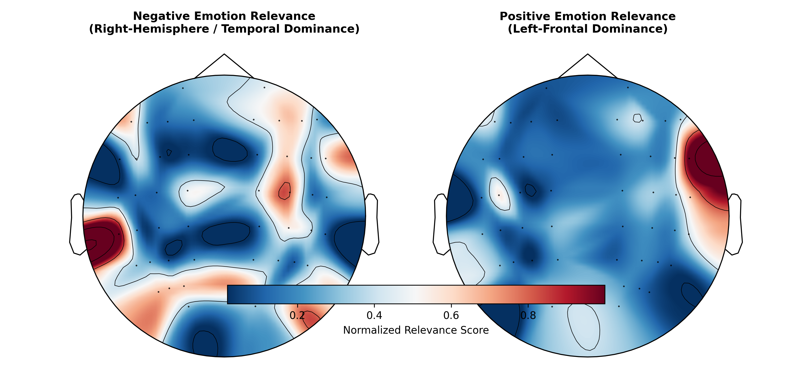
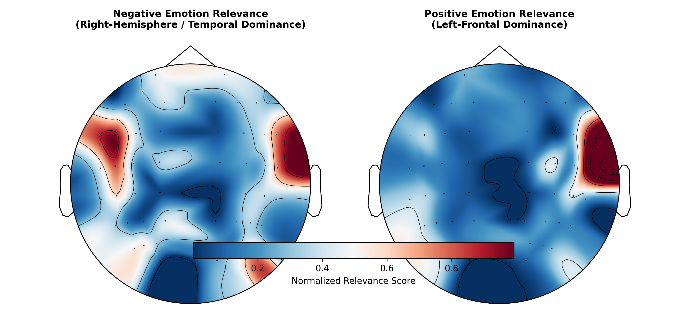

# Interpretable EEG Emotion Recognition with XAI and Brain Topography

<!-- Badges -->


## Overview
Deep learning models applied to electroencephalography (EEG) data frequently achieve high predictive performance, yet their clinical and neuroscientific utility remains limited due to their "black-box" nature. 

This repository presents an interpretable deep learning pipeline for EEG-based emotion recognition using the **SEED Dataset**. By integrating **EEGNet** with **Integrated Gradients (via PyTorch Captum)**, this framework bridges the gap between machine learning classification and neurophysiological interpretability. Instead of merely reporting accuracy metrics, the model's decisions are projected back onto standard brain sensor spaces using **MNE-Python** topographic maps, allowing researchers to inspect the underlying spatiotemporal neural correlates.

---

## What This Project Does
Most EEG deep learning pipelines treat the network as a black box, reporting high accuracy without clinical or biological validation. This pipeline:
1. Classifies 3-class emotional states from 62-channel EEG using a compact CNN (`EEGNet`).
2. Applies axiomatic feature attribution (`Integrated Gradients` via Captum) to calculate the precise importance of each sensor.
3. Visualizes decision weights directly on 2D scalp topographic maps using `MNE-Python`.

---

## Who Is This For & Use Cases
- **Cognitive & Computational Neuroscientists:** Audit neural network decisions against established physiological markers (e.g., frontal asymmetry in valence processing) to confirm the model is not relying on ocular/muscular artifacts.
- **BCI & Affective Computing Engineers:** Identify the most informative subset of electrodes for dimensionality reduction, enabling wearable headsets with fewer channels.
- **Medical AI / Healthcare ML Researchers:** A modular template to incorporate explainability (XAI) into clinical or cognitive biosignal pipelines.

---

## Deliverables & Outputs
- **Trained Feature Extractor & Classifier:** Compact neural architecture tailored for multi-channel EEG decoding.
- **Electrode Relevance Matrix:** Channel-level attribution values quantifying spatial feature contribution.
- **Topographic Scalp Heatmaps:** High-resolution 2D sensor projections contrasting cortical activation patterns across affective states.

---

## Key Methodological Components
1. **Compact Neural Modeling:** Employs `EEGNet`, an efficient convolutional neural network designed specifically for EEG data, separating temporal and spatial filtering to preserve physiological relevance.
2. **Axiomatic Attribution:** Utilizes `Integrated Gradients` to compute reliable feature importance scores without saturation issues inherent in standard gradient methods.
3. **Neuroscientific Validation:** Maps channel-wise attributions to the standard 10-20 electrode layout, facilitating comparison with established cognitive and affective neuroscience frameworks (such as hemispheric lateralization theories).

---

## Repository Structure
```text
eeg-xai-brainmap/
│
├── figures/               # Generated brain topographic relevance maps
├── model.py               # EEGNet architecture implementation
├── data_loader.py         # SEED dataset parsing and windowing utilities
├── xai_engine.py          # Captum-based feature attribution module
├── viz_mne.py             # MNE-Python topographical plotting pipeline
├── run_pipeline.py        # End-to-end training, evaluation, and visualization script
├── requirements.txt       # Project dependencies
└── README.md
```

---

## Getting Started

### Prerequisites
Install the required dependencies:
```bash
pip install -r requirements.txt
```

### Data Preparation
This project is configured for the **SEED Dataset** (Preprocessed time-domain EEG recordings). 
Set your dataset directory path via the environment variable:
```bash
export SEED_DATA_DIR="/path/to/Preprocessed_EEG"  # Linux/macOS
# or in Windows PowerShell:
# $env:SEED_DATA_DIR="C:\path\to\Preprocessed_EEG"
```

### Execution
Run the full pipeline (model training, evaluation, XAI extraction, and brain mapping):
```bash
python run_pipeline.py
```

---

## Explainable AI (XAI) Results & Brain Topography

To validate whether our `EEGNet` model relies on neurobiologically meaningful patterns rather than artifacts, we utilize **Integrated Gradients (Captum)** mapped onto standard 62-channel EEG layouts via **MNE-Python**.

### 1. Group-Averaged Brain Topography
The group-average representation consolidates insights across multiple sessions, minimizing subject-specific anatomical and noise variations to highlight universal affective neural markers:

<p align="center">
  
</p>

* **Why Group-Averaging Matters:** In cognitive neuroscience, individual-level recordings are prone to muscular artifacts, localized skin conductance differences, and anatomical variance. Group-averaging demonstrates that the model captures genuine neuro-electrophysiological principles (such as lateralized hemispheric activation) rather than overfitting to single-subject idiosyncrasies.

---

### 2. Subject-Specific Session Maps (Case Studies)
Below are individual session attributions showcasing consistency across different recording sessions (`se1`, `se2`, `se3`):

<table align="center">
  <tr>
    <td align="center"><b>Subject 10 - Session 1</b></td>
    <td align="center"><b>Subject 10 - Session 2</b></td>
  </tr>
  <tr>
    <td></td>
    <td></td>
  </tr>
  <tr>
    <td align="center"><b>Subject 10 - Session 3</b></td>
    <td align="center"><b>Subject 11 - Session 1</b></td>
  </tr>
  <tr>
    <td></td>
    <td></td>
  </tr>
  <tr>
    <td align="center"><b>Subject 11 - Session 2</b></td>
    <td align="center"><b>Subject 11 - Session 3</b></td>
  </tr>
  <tr>
    <td></td>
    <td></td>
  </tr>
</table>

---

## Citation & Acknowledgments
This work utilizes the SEED dataset provided by the BCMI Laboratory at Shanghai Jiao Tong University.
